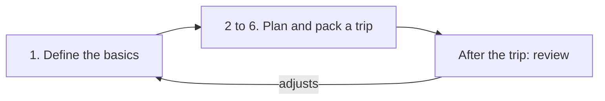

# User flows - What users do in Roundtrip

Roundtrip will be used by our family and should be built fully to our family, without any need for multi-tenancy, minimal configuration, only minimal login ideally with Google account.

Our family includes two adults and two young children. The two adults are the ones preparing and packing together, so this is two player collaboration app.

## High level flow
1. Define the basics. Done once before any trip, then adjusted after trips.
2. Plan what activites we're doing on the trip.
3. Plan what to pack based on that.
4. Gather the items to one place (e.g on top of bed).
5. Review if something is missing and needs to be bought.
6. Pack everything after confirming everything is available.

After the trip I'd want to review what is useful and which were not to remove unuseful items from the future packing list. This is to optimize the packing in the future. I don't do this because it's too time consuming and hard to maintain with current tools.

So the flow is a loop, not a line: the basics are set up once, every trip starts from them, and the review after a trip adjusts them for the next one. Previously the basics lived in a Notion page split into categories (outdoor, hygiene, sports, general).

Other spec files refer to these steps by number. When steps are added, removed or reordered, follow the rule in [README.md](README.md#flow-steps) so those references stay correct.

## What success looks like per step

We rarely forget anything today. The cost is that preparing is an intensive task, so the success measure for Roundtrip is **how much time and energy we spend preparing for a trip**, not how few things we forget.

Each step has a value moment (when the app has clearly helped) and a rough measure. The measures are a gut-feel way for us to pick which step to improve next, assessed by us after a trip, not something the app tracks.

**Rating** is how the step feels right now, 1 to 5: 1 is draining, 5 is effortless. The lowest rating is the next candidate to improve. Ratings are Human-PM's alone: agents never fill in or change them, and propose a re-rating in conversation instead. Why a step feels the way it does, and the ideas for improving it, are in [`product-notes.md`](product-notes.md).

| Step | Value moment | Rough measure | Rating | Rated on |
|---|---|---|---|---|
| 1. Define the basics | A new trip's list needs few changes, because the basics already fit each person | How many basics rows we change on each trip (seen in step 3) | | |
| 2. Plan activities | Picking what we will do takes a minute, and the list follows from it | Minutes from "new trip" to activities chosen | | |
| 3. Plan what to pack | The generated list is nearly right for this trip, so we only adjust for what is special about it | How much of the list we had to review and edit by hand; energy spent | | |
| 4. Gather items | We walk the house once, in an order that matches where things are | Trips around the house; time to gather | | |
| 5. Review what is missing | What needs buying is obvious without reading the whole list | Time to a shopping list | | |
| 6. Pack | Packing each person's bag is quick and nothing is packed twice | Time to pack; taps that went to the wrong row | | |
| After the trip | Saying what was not used, or was missing, takes a couple of minutes | Whether we actually do it; fewer basics changes needed on the next trip | | |
